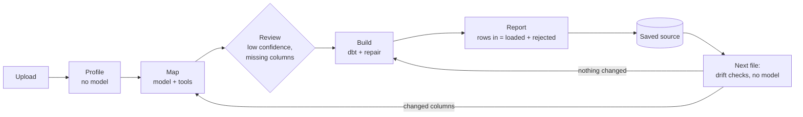

# Data Onboarding Agent

An agent that takes a customer's messy data files and produces clean, tested tables in a target
schema. It profiles the files, proposes a mapping for every column with a confidence score, sends
the uncertain ones to a person, writes and runs dbt models and tests, quarantines what it cannot
load, and reports every row. Files that come back every week or month are checked for changes
and loaded without starting over.

Everything runs on one machine with `make up`. The model is any OpenAI-compatible endpoint
(a local Ollama model by default; the results below use `qwen/qwen3-32b` through OpenRouter).

## The customer problem

Acme Cloud, a B2B SaaS company, is moving its customers off a legacy billing system. Each
customer sends exports of their customers, subscriptions, and invoices, and every export is
different: renamed or cryptic columns (`pln_cd`, `Sign Up Dt`), dates in three formats in one
column, `$1,200.00` next to `1200` and `N/A`, `Pro`/`PRO`/`professional`, two fields glued into
one column, duplicate rows that differ only by case, a required column that is simply missing.
An analyst spent days per customer on column mapping and cleanup, and the next month's export
broke the scripts again.

## The approach



- **The model decides, tools do the work.** The model never sees a whole file: only column
  profiles and at most 20 sample rows. Every data operation is deterministic Python over DuckDB,
  exposed as MCP tools (profile, sample, test a transform, run dbt).
- **The model writes one SQL expression per column, nothing more.** Each `transform_sql` is
  parsed with sqlglot and refused unless it is a single-row expression over the file's own
  columns, then run on a read-only connection. The dbt project, tests, and quarantine logic are
  rendered from templates.
- **Uncertainty goes to a person.** Mappings below the confidence threshold, and required
  columns with no source, wait for review in the web app. The rest is approved but still shown.
- **Quarantine, never drop.** Rows that fail a conversion, a required check, or the unique key
  go to `rejected_<table>` with a reason, and every build asserts
  rows in = rows loaded + rows rejected per file.
- **Repair from evidence.** When dbt fails, or a transform fails on more than 5% of the rows,
  the agent gets the failing rows and values and rewrites the expression, up to three rebuilds.
- **Recurring files without the model.** A finished run can be saved as a source (a versioned
  mapping contract with a baseline profile). The next file is compared with it first: an
  unchanged file loads with zero model calls; added, renamed, or reformatted columns go to the
  model and then to review; a missing required column blocks the load. Rows are upserted on the
  key with `loaded_at` and `run_id`.

Stack: Python 3.12, FastAPI, Postgres + Alembic, DuckDB, dbt-core with dbt-duckdb, the official
MCP SDK, MLflow tracing, Next.js. No agent framework: the tool-calling loop is plain Python.

## Results

All numbers come from `evals/results/`: one file per run with the model, cases, and per-case
detail. The 30 generated cases cover ten corruption types over three tables (2,000 rows each);
a fake "answer key" reviewer plays the person.

### Onboarding: 30 generated cases

| Metric | qwen3-32b, M4 | qwen3-32b, before M8 fixes | qwen3-32b, after | Claude Haiku 5.5, after |
| --- | --- | --- | --- | --- |
| Mapping accuracy | 98.7% | 100% | 100% | 100% |
| Defect recall | 91.7% | 89.6% | **100%** | 100% |
| Defect precision | 75.9% | 77.2% | **86.7%** | 82.9% |
| Cell accuracy (ceiling ≈ 86%) | 83.9% | 84.4% | **86.3%** | 86.3% |
| Build success | 100% | 96.7% | **100%** | 100% |
| Bad auto-approvals | 0 | 0 | 0 | 0 |
| Escalated to a person | 1.8% | 2.6% | 1.7% | 2.2% |
| Model calls / tokens | 39 / 242k | 38 / 205k | 46 / 283k | 76 / 675k |
| Wall time (OpenRouter) | 50 min | 38 min | 66 min | 8 min |

Cell accuracy cannot reach 100%: four cases drop a required column, so every row of those is
correctly quarantined, and planted junk values ("TBD") are quarantined too. Bad auto-approvals
(a wrong mapping confident enough to skip review) stayed at zero in every run.

The error analysis behind the "after" column (details in `docs/DECISIONS.md`, Milestone 8):

| Mistake in the "before" run | Fix | Effect |
| --- | --- | --- |
| Duplicate rows whose IDs differ only by case reported as value drift on the ID (5 cases) | Profiles report `distinct_ignoring_case`; value drift on a column without allowed values is rejected with a hint | All duplicates found |
| Optional, mostly-empty columns left unmapped (3 misses in M4) | Every target needs a decision: mapped or listed as unmapped | No misses |
| Value variants beyond the top 5 never mapped, rows quarantined | Columns with ≤ 30 distinct values show all of them | Value-drift cases: customers_06 83% → 97% of cells, customers_09 91% → 100% |
| Defects reported on extra columns that are never loaded | Dropped during validation | Precision up |
| A transform failing quietly on many values while dbt passes | Such columns go to the repair agent | 4 repairs, no failed build |

The remaining false defects are mostly `null_variants` on columns whose "N/A"-style values
were planted as type noise: a labelling overlap rather than a wrong cleaning.

### Recurring loads: 33 drift cases (qwen3-32b)

100% detection recall and precision, no false alarms on 9 unchanged batches, all of which
loaded with zero model calls, and the right outcome (loaded, or blocked) in 33 of 33 cases.

### External benchmark: Raha (Claude Haiku 5.5)

| Dataset | Rows | Cells correct as delivered | After the agent |
| --- | --- | --- | --- |
| beers | 2,410 | 83.5% | **96.4%** |
| flights | 2,376 | 70.4% | 70.9% |
| hospital | 1,000 | 97.5% | 92.2% |
| All cells | | 84.5% | 88.3% |

Beers is the kind of mess the agent is built for (units in numbers, "N/A", inconsistent
formats) and improves by 13 points. Flights errors are conflicting reports of the same flight
from different websites, which a transform over one row cannot settle. Hospital errors are
typos ("birminghxm"); worse, a typo in a ZIP code or phone number makes the whole row fail its
conversion, so 64 rows were quarantined that were mostly correct. The qwen3-32b benchmark run
was stopped because OpenRouter served it very slowly that day.

## What broke, and how it was fixed

- **A small local model forgot the start of the conversation.** Ollama serves a 4,096-token
  context by default and silently drops older messages; the mapping task starts at about 3,400
  tokens. A Modelfile with a 16k context fixed it.
- **Text in double quotes.** The model wrote `split_part("c", "|", 1)`, which SQL reads as a
  column named `|`, and repeated it until the step limit. The validator now says so in plain
  words, and the prompt states the rule.
- **Value drift hid in the build.** Quarantining every unknown category would have hidden it, so
  `accepted_values` failures go to the repair agent instead (Milestone 4). Recurring loads
  quarantine new categories only after a person has seen the proposal.
- **Trace links opened "Page Not Found"** in MLflow 3.18, which needs the experiment id in the
  URL; runs now store it.
- **Small files raised false "empty values" alarms** in the drift checks; the check now also
  needs the jump to be beyond sampling noise (a two-proportion z-test).
- **The error analysis of Milestone 8** is in the results above and in `docs/DECISIONS.md`.

## Known limits

- No authentication and no multi-tenant access: it is a single-user tool for one machine.
- A row with one value that does not convert is quarantined whole, even when the column is
  optional; on the Raha hospital data that sets aside rows that are otherwise correct.
- Tested on files up to about 12,000 rows; profiling counts value shapes in Python over distinct
  values, so files near 1 GB are untested. Uploads are capped by `MAX_UPLOAD_MB` (1,024).
- One target table per run; the same entity across several files is not merged.
- Transforms work on one row at a time, so errors that need other rows or outside knowledge
  (typos in names, conflicting reports of the same flight) are not fixed; the Raha benchmark
  shows this.
- Only US `MM/DD/YYYY` slash dates exist in the generated data.
- The default setup assumes a hosted model through OpenRouter for speed; with a local Ollama
  model the same code runs, more slowly.

## How to run it

```sh
cp .env.example .env          # set LLM_BASE_URL, LLM_API_KEY, LLM_MODEL
make web-install              # once
make up                       # web http://localhost:3000, API http://localhost:8000/docs, MLflow :5001
```

Open the web app, start a new run, drop a file (for example `evals/cases/customers_09/messy.csv`
after `make seed`), review, and read the report. Save it as a recurring source and drop the
next file on the source's page.

| Command | What it does |
| --- | --- |
| `make test`, `make lint` | Tests (fake model, no network) and linters |
| `make seed` | Generate the clean tables, 30 eval cases, and 33 drift cases |
| `make eval` / `make eval-smoke` | Score the configured model / the answer-key fake on the cases |
| `make eval-drift` | Score drift detection on the 33 drift cases |
| `make benchmark-cases`, `make eval-benchmark` | Download and score the Raha benchmark |
| `make pull-311 DATE=YYYY-MM-DD` | Load one day of NYC 311 service requests |
| `make onboard FILE=... SCHEMA=...` | Run one file from the command line |

See `docs/runbook.md` for operations (reset, traces, recovering a failed run),
`docs/DECISIONS.md` for every design choice, and `PROJECT_SPEC.md` for the original spec.

## Data and credits

All customer data is generated with Faker. The external benchmark uses the hospital, flights,
and beers datasets from Raha (Mahdavi et al., [github.com/BigDaMa/raha](https://github.com/BigDaMa/raha),
Apache-2.0), downloaded at a pinned commit and not redistributed here. The live source is NYC
Open Data, 311 Service Requests (dataset `erm2-nwe9`).
