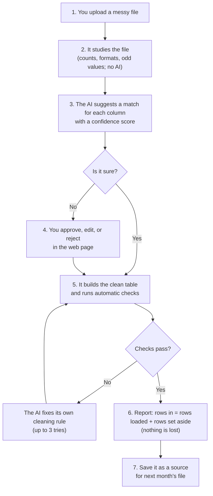
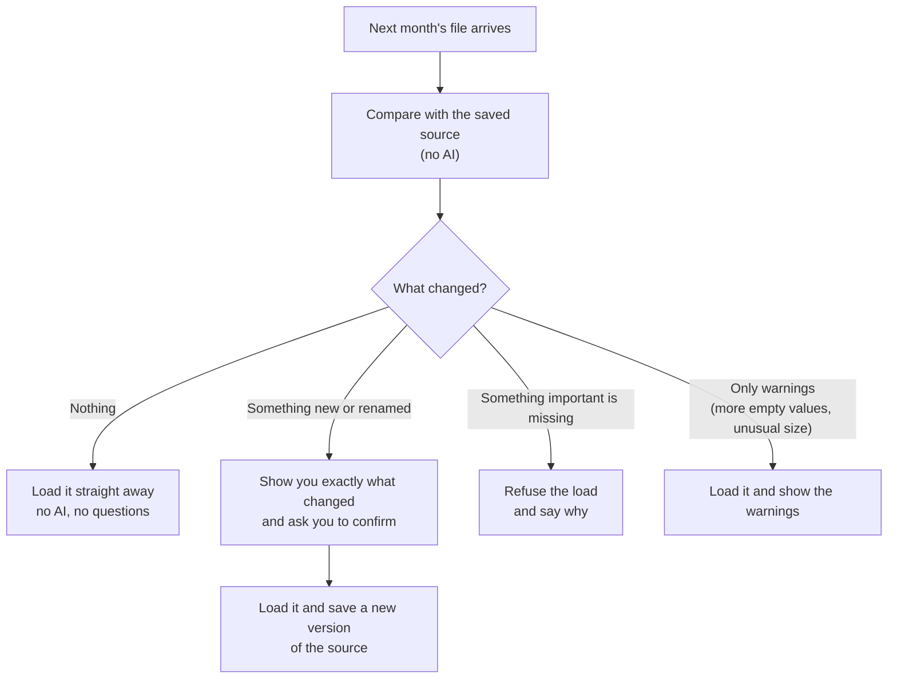

# The project in simple words

## The problem

Acme Cloud (an invented company) is moving its customers from an old billing system to a new
one. Each customer sends spreadsheets of their accounts, subscriptions, and invoices, and every
customer's files are messy in their own way:

- columns with odd names, like "pln_cd" instead of "plan"
- dates written three different ways in the same column
- money written as "$1,200.00", "1200", or "N/A"
- the same plan spelled "Pro", "PRO", and "professional"
- duplicate rows and missing columns

A person used to spend days per customer sorting this out by hand.

## What the project does

It is an assistant that does most of that cleanup for you, and asks a person only when it is
unsure.

1. **You upload a file** in the web page.
2. **It studies the file**: counts empty cells and spots formats and odd values. No AI is used
   in this step.
3. **The AI suggests a match for each column**, for example "'Sign Up Dt' is the signup date,
   and here is how to clean it", with a confidence score.
4. **You check the uncertain ones.** Anything it is not sure about is shown to you to approve,
   edit, or reject.
5. **It builds the clean table**, cleaning every row and running automatic checks. If a check
   fails, the AI tries to fix its own cleaning rule, up to three times.
6. **Nothing is lost.** Rows it cannot clean are set aside with a reason, and the report always
   adds up: rows in = rows loaded + rows set aside.
7. **Next month's file is handled automatically**, once you save the first file as a source.

## Next month's file

The new file is compared with the saved one before anything else happens:

## How well it works

| Test | Result |
| --- | --- |
| Columns matched correctly (30 messy test files) | 100% |
| Data problems found that we had planted in the files | 100% |
| Wrong matches it was confident enough to skip asking you | 0 |
| Changes spotted in next month's files (33 tests) | 100%, with no false alarms |
| Real-world outside data ("beers" dataset) | Correct cells went from 83.5% to 96.4% |

## What it cannot do

- It cannot fix typos like "birminghxm": it cleans one row at a time and does not know what the
  word should be.
- It runs on one computer, for one user, with no log-in.
- It has been tried on files of about 12,000 rows, not on very large ones.

## What it is built with

- **AI:** a model reached over the internet through OpenRouter (currently qwen3-32b). It can be
  swapped for another model by changing one setting.
- **Data work:** done by ordinary, predictable code. The AI only decides how to match and clean
  each column. It never sees the whole file, only summaries and a few sample rows.
- **Logging:** every step and AI call is recorded (in MLflow), so you can see why something
  happened.

**In short:** messy spreadsheets go in, and clean, checked tables come out. A person only steps
in when the assistant is unsure, and repeat files load on their own.

For the technical write-up, see the [README](../README.md); for running and fixing the system,
see the [runbook](runbook.md).
